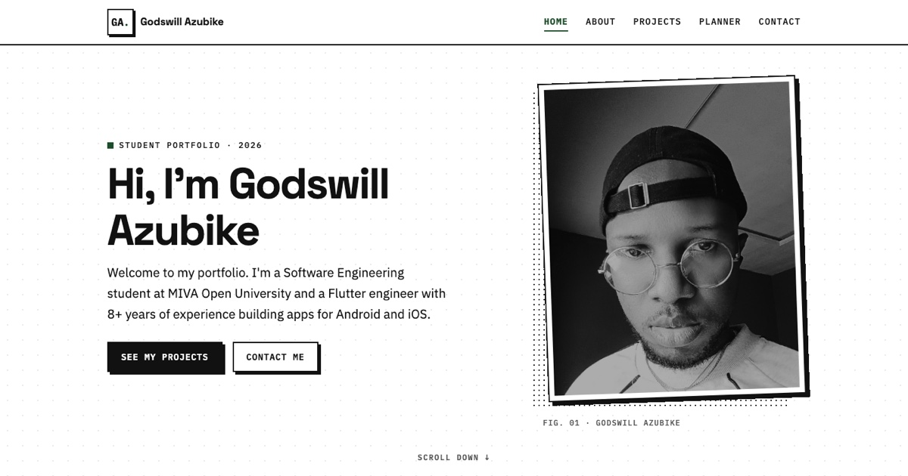

# Godswill Azubike · Student Portfolio



My student portfolio for my Software Engineering course at MIVA Open University. It's five pages built with plain **HTML, CSS and JavaScript**, with no frameworks and no build step. The look is minimal and retro: black, white and a touch of dark green.

---

## The pages

### Home · `index.html`

- Full-screen welcome with my name and a framed photo
- **Hear from me**: a short voice note in my own voice
- A short bio and a full-width link to the About page
- Cards that link to every other page

### About · `about.html`

- Education and work experience
- Career aspirations: my goal of becoming an AI mobile engineer, in three steps
- Technical skills, teaching and community work, and hobbies
- **Me over the years**: a photo gallery that scrolls on its own

### Projects · `projects.html`

- Four real apps I've helped build, each with an image, one line about it and a link
- **Watch me teach**: my YouTube tutorial on setting up VS Code

### Academic Planner · `planner.html`

- Add school tasks, mark them done, filter and delete them
- A progress bar and task counts that update as you go
- Tasks are saved in the browser, so they're still there after a refresh

### Contact · `contact.html`

- A form for name, email, phone number and message
- JavaScript checks that nothing is empty, the email looks right and the phone number is digits only

---

## Built with

- **HTML5**, using semantic elements throughout
- **CSS3**, in one stylesheet, with Flexbox, Grid and keyframe animations
- **JavaScript**, plain and with no libraries
- **Fonts:** Space Grotesk for headings, IBM Plex Sans for body text and IBM Plex Mono for labels, all from Google Fonts

## Run it

1. Download or clone this folder.
2. Open `index.html` in any modern browser.

That's enough for almost everything. The YouTube video only plays when the site is opened from a web address, such as a local server (`student-portfolio.test` with Laravel Herd, or `python3 -m http.server`) or the live site.

## Folder structure

```
student-portfolio/
├── index.html          Home
├── about.html          About me
├── projects.html       Projects and the YouTube video
├── planner.html        Academic planner
├── contact.html        Contact form
├── css/
│   └── style.css       The only stylesheet
├── js/
│   ├── main.js         Every page: menu, footer year, photo gallery
│   ├── planner.js      Task manager
│   └── contact.js      Form validation
├── images/             Photos, project images, link preview image, favicon
└── media/
    └── voice_recording.m4a   My welcome voice note
```

---

## Assignment checklist

### HTML

- [x] Semantic elements: `header`, `nav`, `main`, `section`, `article`, `aside`, `figure`, `address`, `footer`
- [x] Forms: the planner and the contact page
- [x] A table: education on the About page
- [x] Images, hyperlinks and lists across the site
- [x] Multimedia: the `<audio>` voice note on Home and an embedded YouTube video on Projects

### CSS

- [x] One external stylesheet
- [x] Flexbox and Grid layouts
- [x] Responsive and mobile-friendly, with a drop-down menu on phones
- [x] Styled navigation that highlights the current page
- [x] Transitions: buttons, cards and photos react on hover, and photos go from black and white to colour
- [x] Animations: sections fade up, the cursor blinks, new tasks slide in and the gallery scrolls
- [x] One colour scheme: black, white and dark green
- [x] All motion turns off for people who choose "reduce motion" on their device

### JavaScript

- [x] Event handling and DOM manipulation
- [x] Form validation on the contact page
- [x] Dynamic updates: task counts, the progress bar and the character counter
- [x] Arrays and functions to store and manage tasks
- [x] An interactive task manager in the Academic Planner

---

## Author

**Godswill Azubike**, a mobile engineer and 100 Level Software Engineering student at MIVA Open University.

[GitHub](https://github.com/Godswill-Azubike) · [LinkedIn](https://www.linkedin.com/in/godswill-azubike) · [YouTube](https://www.youtube.com/@godswillazubike)
